# BMW M6 E63: a one-page car launch site on WordPress

A premium single-page site about the BMW M6 coupé (E63, 2005–2010), built as a custom WordPress theme. The brief was simple: make it feel like the launch pages of Porsche, Ferrari and Koenigsegg. A visitor should hear the V10, see the car in detail and read the real numbers. And every word and picture must stay editable in the WordPress admin.

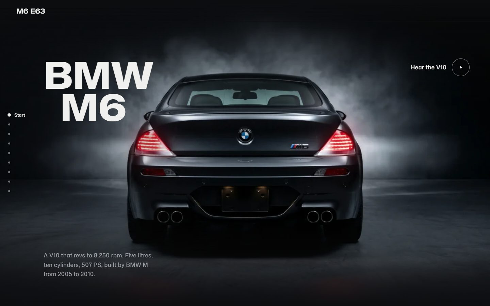

## What the page does

- **Night and day chapters.** The studio alternates between a dark graphite set and a light grey one. There are nine chapters: hero, profile, design, V10, drive, film, spec sheet, heritage and contact.
- **The sound of the V10 is the centrepiece.** The engine bay fills the screen with one button on it. Press it and the recording plays, the photo lights up and a ring around the button runs with the sound.
- **Design hotspots, after Ferrari.** Points sit on the car. Select one and the car zooms into it while a detail panel slides in with a photo and a short text. Esc or Close brings the keyboard focus back to the point.
- **A panoramic driving film.** A 20:9 muted loop runs edge to edge. It loads and plays only while it is on screen, and it has a pause button. With reduced motion it waits for a click.
- **Spec sheet tabs, after Koenigsegg.** The photo changes with a diagonal wipe and the rows fade in. Arrow keys, Home and End work.
- **Scroll scenes without scroll-jacking.** The hero hands over to the side profile, and full-bleed photos open from an inset card as they come in. Scrolling stays native: no GSAP, no Lenis, no smooth-scroll library.

| | |
|---|---|
| 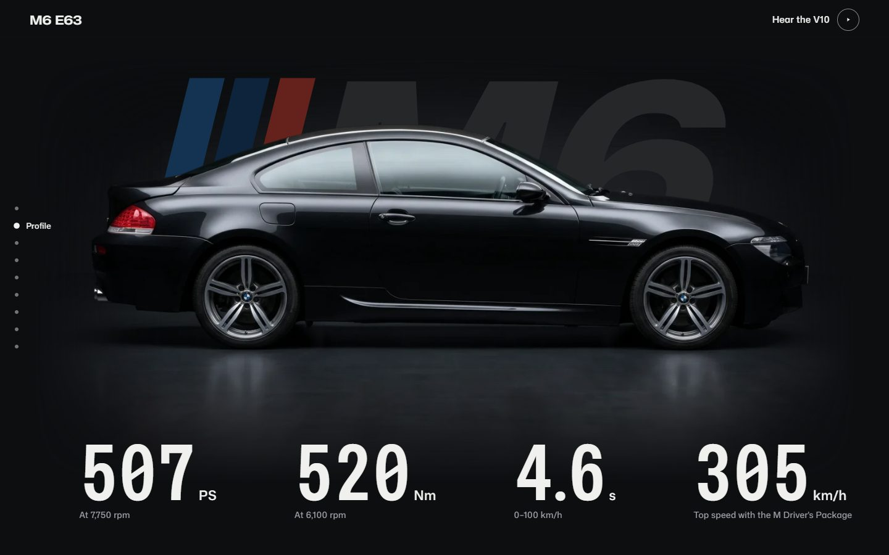 | 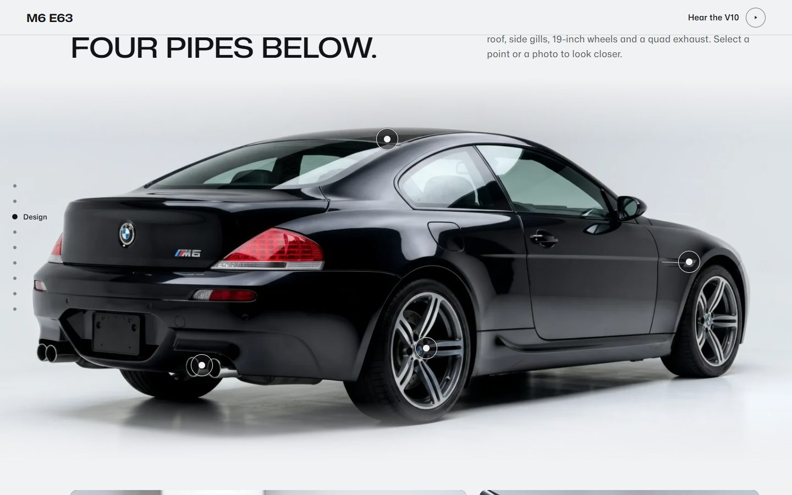 |
| 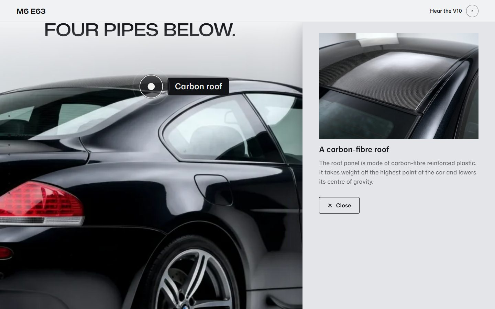 | 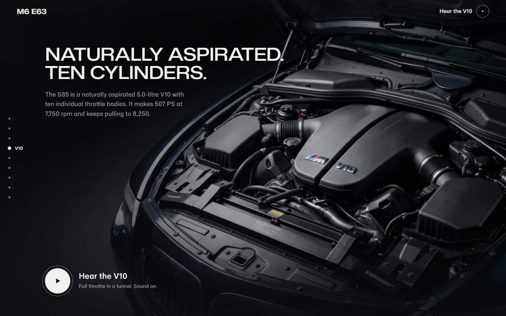 |
| 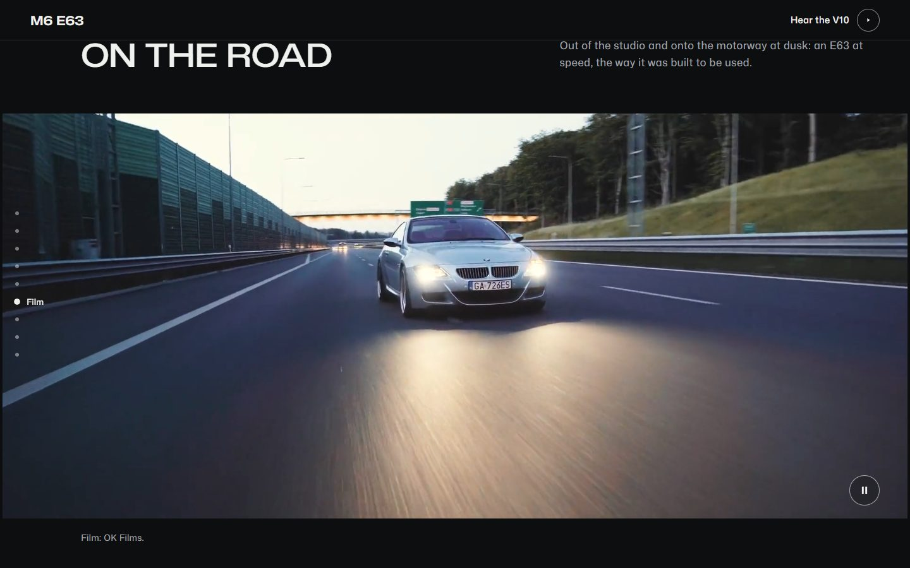 | 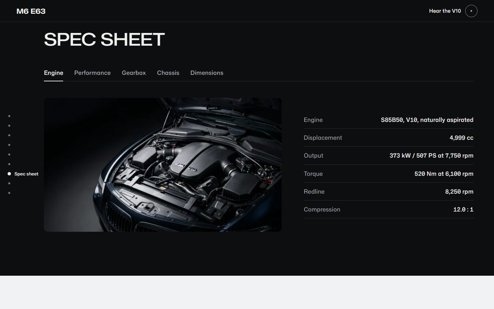 |

## On phones

The layout is designed for phones, not just shrunk to fit:

- the hero is re-cropped for portrait screens;
- hotspots get 44 px tap areas;
- the spec tabs become a sideways strip;
- the film switches to a lighter 960 px file.

| | | | | |
|---|---|---|---|---|
| 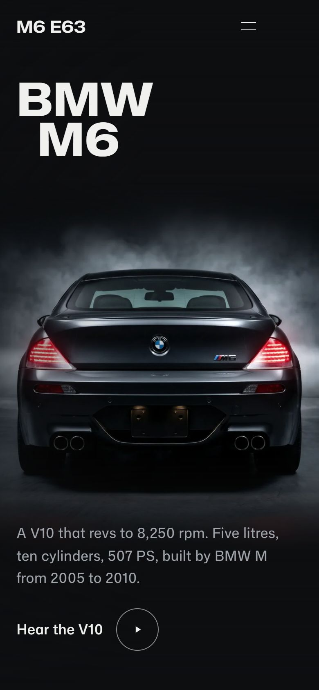 | 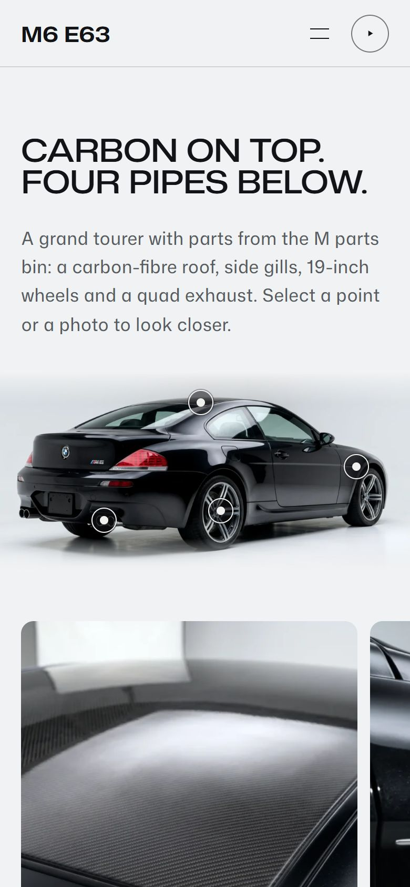 | 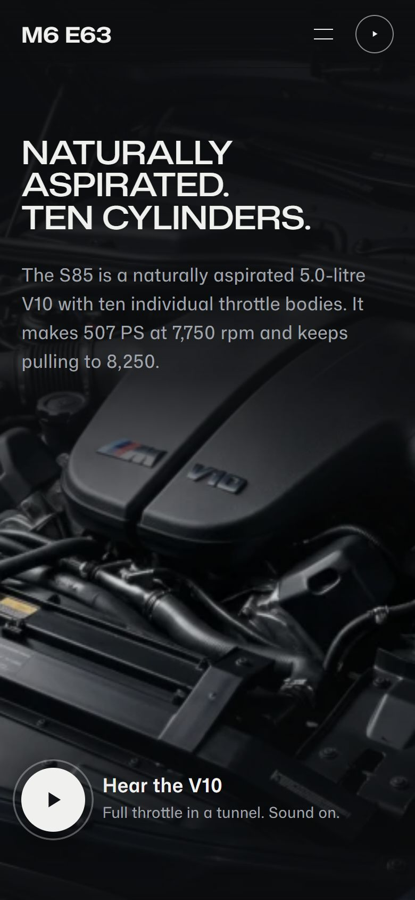 | 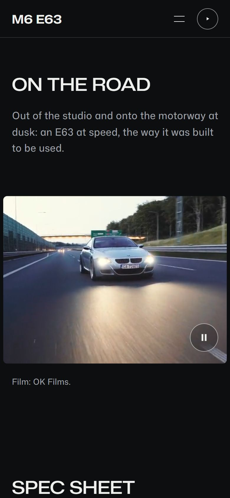 | 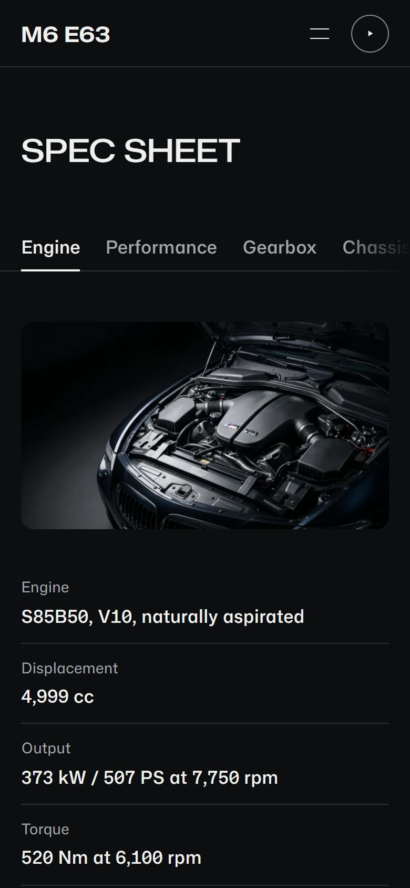 |

## Editable by the client

- **Content.** Every text, photo, hotspot, figure, spec row and the film are ACF PRO fields on the front page. Nothing visible is hard-coded in the templates.
- **Chapters.** Any chapter can be hidden or renamed, or given a new anchor. The chapter rail updates on its own.
- **Site settings.** A "M6 Settings" page holds the header labels, the credits, the V10 recording, the page title, the link preview image and the 404 texts.
- **Field definitions.** The fields live in the theme as Local JSON, so they travel with the code.

## Quality

- **Speed and smoothness.** The page reaches LCP in about 0.2 s locally with no layout shift (CLS 0). It scrolls at 60 fps in every chapter, with and without GPU acceleration, and has no long tasks.
- **Light front end.** All JavaScript is 17 KB unminified, 5 KB gzipped: vanilla ES modules, no jQuery. The fonts, sound and film are self-hosted, with no CDNs and no Google Fonts.
- **Accessibility.**
  - one h1 and AA contrast in both tones;
  - full keyboard support and a visible focus that never hides under the header;
  - a skip link and a pause button for the moving film;
  - a complete reduced-motion version.
- **Without JavaScript.** Everything is still visible. The hotspots become cards, the tabs are stacked and the native audio and video players are shown.
- **Search and sharing.** The page has a title, a meta description, Open Graph and Twitter tags with a 1200×630 preview, and JSON-LD. The theme steps aside if an SEO plugin is installed.
- **Checks.** Headless Chrome checks pass at 1440, 768 and 390 px and in reduced motion with 0 failures. PHPCS with WordPress Coding Standards reports 0 errors, and there are no PHP notices with `WP_DEBUG` on.

## Stack

| Area | Tools |
|---|---|
| Theme | Classic PHP WordPress theme |
| Content | ACF PRO |
| Front end | Vanilla ES modules, CSS with design tokens |
| Typeface | Mona Sans (variable width axis) |
| Assets | Python tools for photo cut-outs and grading; ffmpeg for the film |

## Credits

The studio shots of the car are AI-generated (Gemini) and retouched by hand. The detail, engine and heritage photos are BMW press photos. The driving film is by OK Films. All credits are listed in the site footer.
